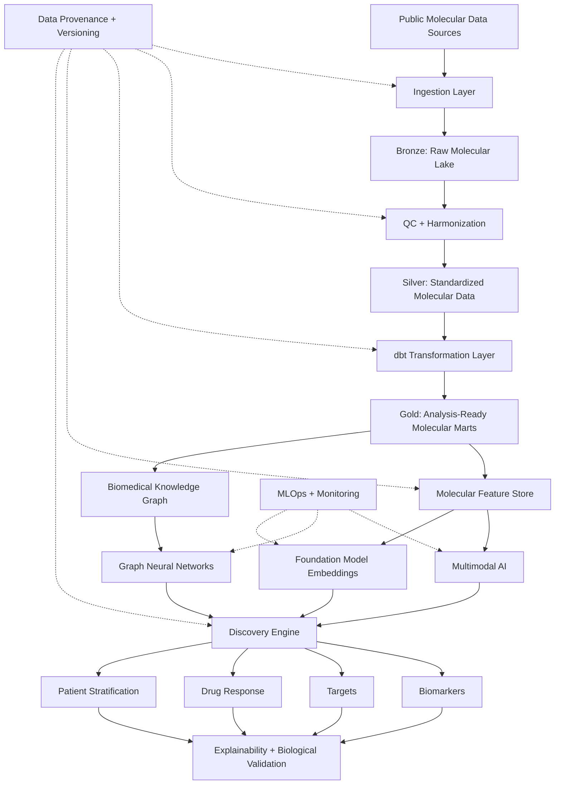

<p align="center">
  
</p>

<p align="center">
  <strong>A provenance-aware molecular data engineering platform that transforms heterogeneous biomedical data into AI-ready representations for biomarker discovery, therapeutic target prioritization, drug-response modeling, and translational research.</strong>
</p>

<p align="center">
  <a href="https://github.com/mtariqi/MOL-ENGINE-AI/actions"></a>
  
  
  
  
  
  
  
  
  <a href="LICENSE"></a>
</p>

<p align="center">
  <a href="#-project-vision">Vision</a> •
  <a href="#-scientific-objective">Scientific Objective</a> •
  <a href="#-architecture">Architecture</a> •
  <a href="#-data-sources">Data Sources</a> •
  <a href="#-research-modules">Research Modules</a> •
  <a href="#-roadmap">Roadmap</a> •
  <a href="#-reproducibility">Reproducibility</a>
</p>

---

# 🧬 MOL-ENGINE-AI

## Molecular Data Engineering and Multimodal Artificial Intelligence for Translational Biomedical Discovery

Molecular biology has entered a data-rich era. Genomics, transcriptomics, epigenomics, proteomics, phosphoproteomics, CRISPR screening, pharmacogenomics, pathway databases, molecular interaction networks, and clinical outcomes are increasingly available at unprecedented scale.

The central challenge is no longer simply acquiring molecular data.

The challenge is **engineering heterogeneous molecular evidence into reproducible, biologically coherent, provenance-aware, machine-learning-ready representations**.

**MOL-ENGINE-AI** is designed to address that problem.

The platform unifies molecular data engineering, bioinformatics, knowledge graphs, multimodal machine learning, graph neural networks, biological foundation models, explainable AI, data-quality intelligence, and MLOps into a single reproducible research architecture.

> **Research thesis:** Better molecular AI begins with better molecular data engineering.

---

## 🌟 Project Vision

MOL-ENGINE-AI aims to create a reusable molecular intelligence layer connecting:

```text
DNA
 ↓
RNA
 ↓
Protein
 ↓
Pathway
 ↓
Cellular State
 ↓
Phenotype
 ↓
Drug Response
 ↓
Clinical Outcome
```

Instead of developing isolated predictive models for individual datasets, the project builds a reusable infrastructure capable of supporting multiple biomedical research applications.

Potential downstream domains include:

- cancer biology
- precision oncology
- immune escape
- drug resistance
- biomarker discovery
- target prioritization
- drug repurposing
- patient stratification
- aging biology
- rare disease research
- multi-omics translational medicine

---

## 🎯 Scientific Objective

### Primary research question

> **Can systematic molecular data engineering improve the reproducibility, biological validity, interpretability, and generalizability of multimodal biomedical AI models across heterogeneous molecular datasets?**

### Secondary objectives

1. Build reproducible ingestion pipelines for heterogeneous molecular datasets.
2. Harmonize molecular identifiers across genomics, transcriptomics, proteomics, pharmacology, and clinical sources.
3. Create a provenance-aware molecular lakehouse.
4. Develop automated molecular data-quality intelligence.
5. Construct reusable molecular and patient feature stores.
6. Build a heterogeneous biomedical knowledge graph.
7. Train multimodal AI models across multiple molecular modalities.
8. Apply graph neural networks for relationship and link prediction.
9. Integrate biological foundation-model embeddings.
10. provide explainable and biologically validated predictions.
11. Track lineage from AI prediction back to source molecular evidence.

---

## 🏗 Architecture



---

## 🧱 Molecular Lakehouse Design

MOL-ENGINE-AI follows a Medallion-style molecular data architecture.

### Bronze — Raw molecular evidence

Examples:

```text
raw_tcga_expression
raw_tcga_variants
raw_tcga_clinical
raw_cptac_proteomics
raw_depmap_crispr
raw_drug_response
raw_pathways
raw_ppi_network
```

Data may initially arrive as:

- FASTQ
- BAM/CRAM
- VCF
- MAF
- TSV
- CSV
- JSON
- HDF5
- AnnData
- Parquet

### Silver — Harmonized molecular layer

Examples:

```text
normalized_expression
harmonized_variants
normalized_proteomics
gene_dependency
standardized_drug_response
standardized_clinical
resolved_gene_identifiers
```

### Gold — Biological analytical marts

Examples:

```text
patient_molecular_profile
gene_molecular_profile
pathway_activity
gene_drug_relationship
gene_dependency_profile
patient_outcomes
multimodal_training_matrix
```

---

## 🗃 Data Sources

The initial implementation is designed around publicly available molecular and biomedical resources.

| Domain | Candidate Resources | Molecular Role |
|---|---|---|
| Cancer genomics | TCGA / NCI GDC | Mutation, CNV, RNA-seq, clinical |
| Normal tissue | GTEx | Reference gene expression |
| Functional genomics | DepMap | CRISPR dependency |
| Proteomics | CPTAC | Protein and phosphoprotein abundance |
| Transcriptomics | GEO | External expression datasets |
| Protein interactions | STRING | PPI network |
| Pathways | Reactome / MSigDB | Biological pathway annotations |
| Drug-target evidence | DGIdb / ChEMBL / Open Targets | Target and pharmacology relationships |
| Variants | ClinVar | Clinical variant interpretation |
| Gene annotation | Ensembl / NCBI / UniProt | Cross-database molecular identity |

> Dataset licensing and access conditions must be reviewed before redistribution.

---

## 🔗 Molecular Entity Resolution

A core engineering problem is that the same biological entity may have multiple identifiers.

Example:

```text
TP53
 ├── Entrez: 7157
 ├── Ensembl: ENSG00000141510
 ├── UniProt: P04637
 └── RefSeq: NM_000546
```

MOL-ENGINE-AI will maintain canonical molecular entities and identifier mappings.

### Target canonical dimensions

```text
dim_gene
dim_protein
dim_variant
dim_pathway
dim_drug
dim_disease
dim_sample
dim_patient
dim_dataset
```

This reduces silent cross-dataset joins and supports reproducible multimodal integration.

---

## 🧪 Molecular Data Quality Intelligence

Traditional data pipelines detect technical errors.

Biomedical pipelines must also detect **biological inconsistencies**.

The Molecular Data Quality module will evaluate:

### Technical quality

- missingness
- duplicate samples
- schema drift
- invalid ranges
- corrupt records
- inconsistent sample identifiers
- unexpected cardinality
- data-type violations

### Biological quality

- implausible expression distributions
- tumor/normal inconsistencies
- sex-chromosome inconsistencies
- suspicious sample swaps
- unexpected pathway-level patterns
- batch effects
- cross-omic disagreement
- abnormal molecular profiles

### Candidate algorithms

- Isolation Forest
- Local Outlier Factor
- robust covariance
- autoencoders
- variational autoencoders
- PCA-based QC
- batch-effect detection
- multimodal consistency scoring

A future output will be a:

> **Molecular Data Quality Score (MDQS)**

for datasets, samples, and selected molecular features.

---

## 🧠 Molecular Feature Store

Reusable feature engineering will prevent each downstream experiment from recreating molecular features independently.

### Gene-level features

```text
expression
mutation_frequency
copy_number
methylation
protein_abundance
phosphoprotein_activity
crispr_dependency
network_degree
betweenness_centrality
pathway_membership
druggability
disease_association
protein_embedding
```

### Patient-level features

```text
mutation_burden
gene_expression_signature
pathway_activity
immune_signature
molecular_subtype
protein_signature
clinical_covariates
multimodal_embedding
```

---

## 🕸 Biomedical Knowledge Graph

The knowledge graph will model relationships among:

### Nodes

- Gene
- Protein
- Variant
- Pathway
- Drug
- Disease
- Phenotype
- Cell line
- Sample
- Patient

### Example edges

```text
Gene ──ENCODES──────────> Protein
Variant ──AFFECTS───────> Gene
Gene ──MEMBER_OF────────> Pathway
Protein ──INTERACTS_WITH> Protein
Drug ──TARGETS──────────> Protein
Gene ──ESSENTIAL_IN─────> CellLine
Drug ──SENSITIVE_IN─────> CellLine
Pathway ──ASSOCIATED_WITH> Disease
```

Potential graph technologies:

- Neo4j
- NetworkX
- PyTorch Geometric
- DGL

---

## 🤖 Research Modules

### Module 1 — Molecular Subtype Discovery

Candidate methods:

- PCA / NMF baselines
- autoencoders
- variational autoencoders
- multimodal representation learning
- contrastive learning
- transformer-based integration

---

### Module 2 — Biomarker Discovery

Candidate models:

- Elastic Net
- Random Forest
- XGBoost
- LightGBM
- neural networks

Interpretation:

- SHAP
- permutation importance
- pathway enrichment
- network-context analysis

---

### Module 3 — Drug Response Modeling

Inputs may combine:

```text
Tumor molecular profile
+
Gene dependency
+
Drug-target relationships
+
Protein network context
+
Pathway activity
```

Outputs:

- predicted drug sensitivity
- resistant molecular states
- candidate combination therapies
- drug-response biomarkers

---

### Module 4 — Graph Neural Networks

Candidate architectures:

- GCN
- GraphSAGE
- GAT
- heterogeneous GNN
- knowledge-graph embeddings

Potential tasks:

- gene-disease link prediction
- drug-target prediction
- drug repurposing
- pathway relationship prediction
- synthetic-lethal interaction prioritization

---

### Module 5 — Biological Foundation Models

Potential representations include embeddings for:

- DNA sequences
- proteins
- single cells
- genes
- molecular text/knowledge

Conceptually:

```text
DNA sequence ────────> sequence embedding
Protein sequence ───> protein embedding
Single-cell profile -> cell-state embedding
Knowledge graph ─────> graph embedding
Multi-omics ─────────> molecular embedding
```

These representations can later be fused into a unified latent molecular representation.

---

## 🧮 Multimodal Representation

For biological entity \(i\), the project aims to learn:

\[
Z_i =
f(
X^{genomics}_i,
X^{transcriptomics}_i,
X^{proteomics}_i,
X^{epigenomics}_i,
X^{functional}_i,
X^{network}_i,
X^{clinical}_i
)
\]

where \(Z_i\) is a biologically informed latent representation used by downstream models.

---

## 🔍 Explainable AI

Predictive performance alone is insufficient for translational molecular research.

Each model should answer:

1. What was predicted?
2. Which molecular variables influenced the prediction?
3. Which pathways support the result?
4. Which network relationships support the result?
5. Is the signal reproducible in an external dataset?
6. Is the prediction biologically plausible?
7. Can the prediction be traced to source evidence?

---

## 🧾 Provenance-First Design

Every prediction should be traceable through:

```text
Prediction
   ↓
Model version
   ↓
Feature version
   ↓
Transformation version
   ↓
Processed dataset
   ↓
Raw dataset
   ↓
Source database
```

Core provenance metadata will include:

- source database
- dataset version
- access date
- genome build
- identifier namespace
- transformation version
- normalization method
- pipeline version
- feature version
- model version

---

## ✅ Data Testing Strategy

### Software assertions

Examples:

```text
gene_id IS NOT NULL
sample_id IS UNIQUE
expression >= 0
0 <= methylation_beta <= 1
gene_id exists in gene dimension
patient_id exists in patient dimension
genome_build IN ('GRCh37', 'GRCh38')
```

### Biological assertions

Examples:

- expected ranges for known molecular distributions
- known cancer-specific alteration patterns
- tumor/normal label consistency
- sex-chromosome consistency
- expected positive-control relationships
- expected pathway-level correlations

The goal is to integrate:

> **software testing + statistical QC + biological validation**

into one pipeline.

---

## ☁️ Data Engineering Stack

### Core

- Python
- SQL
- Polars / pandas
- DuckDB
- Parquet
- PyArrow

### Orchestration

- Apache Airflow

### Analytics Engineering

- dbt

### Distributed Computing

- Apache Spark

### Storage / Warehouse

Architecture will remain cloud-portable.

Candidate implementations:

- AWS S3 + Glue/EMR + Redshift
- Azure Data Lake + Databricks + Synapse
- GCP Cloud Storage + Dataproc + BigQuery
- Snowflake for analytical warehouse workloads

### Machine Learning

- scikit-learn
- XGBoost
- LightGBM
- PyTorch
- PyTorch Geometric

### MLOps

- MLflow
- DVC
- GitHub Actions
- Docker
- Great Expectations / custom biological validators

### Serving

- FastAPI
- Streamlit

---

## 📁 Planned Repository Structure

```text
MOL-ENGINE-AI/
│
├── README.md
├── LICENSE
├── CONTRIBUTING.md
├── CODE_OF_CONDUCT.md
├── SECURITY.md
├── CHANGELOG.md
├── Makefile
├── pyproject.toml
├── docker-compose.yml
├── .env.example
│
├── .github/
│   └── workflows/
│
├── configs/
│
├── data/
│   ├── bronze/
│   ├── silver/
│   └── gold/
│
├── ingestion/
│   ├── gdc/
│   ├── geo/
│   ├── cptac/
│   └── depmap/
│
├── airflow/
│   └── dags/
│
├── dbt/
│   ├── staging/
│   ├── intermediate/
│   └── marts/
│
├── molecular_qc/
│
├── entity_resolution/
│
├── feature_store/
│
├── knowledge_graph/
│
├── models/
│   ├── baseline/
│   ├── multimodal/
│   ├── gnn/
│   └── foundation_models/
│
├── explainability/
│
├── validation/
│
├── api/
│
├── dashboard/
│
├── notebooks/
│
├── tests/
│
├── terraform/
│
└── docs/
```

---

## 🗺 Roadmap

### Phase 0 — Repository Engineering
- [x] Define project scientific vision
- [x] Define molecular data architecture
- [x] Design initial repository structure
- [ ] Configure Python project
- [ ] Add pre-commit hooks
- [ ] Add linting and formatting
- [ ] Add unit tests
- [ ] Configure CI

### Phase 1 — Molecular Data Ingestion
- [ ] GDC/TCGA ingestion
- [ ] CPTAC ingestion
- [ ] DepMap ingestion
- [ ] GEO ingestion
- [ ] pathway-data ingestion
- [ ] interaction-network ingestion

### Phase 2 — Molecular Lakehouse
- [ ] Bronze layer
- [ ] Silver layer
- [ ] Gold marts
- [ ] schema contracts
- [ ] data versioning
- [ ] provenance tables

### Phase 3 — Identifier Harmonization
- [ ] gene identifier resolver
- [ ] protein identifier resolver
- [ ] variant normalization
- [ ] drug identifier resolver
- [ ] canonical molecular dimensions

### Phase 4 — Molecular Quality Intelligence
- [ ] technical QC
- [ ] biological QC
- [ ] batch detection
- [ ] sample anomaly detection
- [ ] Molecular Data Quality Score

### Phase 5 — Molecular Feature Store
- [ ] gene-level features
- [ ] patient-level features
- [ ] pathway features
- [ ] graph features
- [ ] embedding registry

### Phase 6 — Knowledge Graph
- [ ] graph schema
- [ ] graph construction
- [ ] relationship validation
- [ ] graph statistics
- [ ] graph embeddings

### Phase 7 — Baseline AI
- [ ] biomarker models
- [ ] subtype models
- [ ] drug-response models
- [ ] robust cross-validation

### Phase 8 — Multimodal AI
- [ ] multimodal autoencoder
- [ ] contrastive integration
- [ ] modality-ablation experiments
- [ ] cross-cohort validation

### Phase 9 — Graph AI
- [ ] GraphSAGE
- [ ] GAT
- [ ] heterogeneous GNN
- [ ] link-prediction benchmark

### Phase 10 — Foundation Models
- [ ] protein embeddings
- [ ] genomic embeddings
- [ ] cell-state embeddings
- [ ] multimodal fusion

### Phase 11 — Explainability + Validation
- [ ] SHAP
- [ ] pathway interpretation
- [ ] network interpretation
- [ ] external dataset validation
- [ ] robustness analysis

### Phase 12 — Deployment
- [ ] MLflow registry
- [ ] FastAPI
- [ ] Streamlit dashboard
- [ ] Docker
- [ ] cloud deployment
- [ ] reproducible research release

---

## 📊 Evaluation Framework

Models will be evaluated using both computational and biological criteria.

### Predictive metrics

Depending on task:

- AUROC
- AUPRC
- F1
- balanced accuracy
- MCC
- RMSE
- MAE
- \(R^2\)
- concordance index

### Robustness metrics

- nested cross-validation
- bootstrap confidence intervals
- external-cohort validation
- temporal validation where applicable
- batch sensitivity
- modality-ablation analysis
- missing-modality robustness

### Biological evaluation

- pathway enrichment
- literature-supported associations
- known positive controls
- network coherence
- functional-genomic concordance
- cross-omics consistency

---

## 🔬 Example Translational Applications

The platform is intentionally disease-agnostic.

Possible applications include:

### Precision oncology

```text
Patient Multi-Omics
       ↓
Molecular Representation
       ↓
Resistance Pathway Detection
       ↓
Target Prioritization
       ↓
Drug / Combination Ranking
```

### Immune escape

```text
Tumor genomics
+
Tumor transcriptomics
+
Immune signatures
+
Proteomics
+
CRISPR dependencies
       ↓
Multimodal AI
       ↓
Candidate immune-escape mechanisms
```

### Molecular aging

```text
Genomic + epigenomic + transcriptomic + proteomic evidence
       ↓
Molecular aging representation
       ↓
Pathway / biomarker discovery
```

---

## 🧰 Development Principles

MOL-ENGINE-AI follows several principles:

1. **Reproducibility before complexity**
2. **Biological validity before leaderboard performance**
3. **Data lineage for every prediction**
4. **No hidden train/test leakage**
5. **Patient-level splitting when required**
6. **External validation whenever possible**
7. **Versioned molecular identifiers**
8. **Explicit handling of genome builds**
9. **Modular and cloud-portable architecture**
10. **AI predictions remain hypotheses until biologically validated**

---

## 🔁 Reproducibility

Planned reproducibility stack:

```text
Git
+
GitHub
+
Docker
+
DVC
+
MLflow
+
dbt
+
Airflow
+
Data Contracts
+
Automated Tests
```

A future experiment should be reproducible from:

```text
commit SHA
+
dataset version
+
feature-set version
+
configuration
+
random seed
+
container image
+
model artifact
```

---

## 🚀 Quick Start

> Implementation will be added incrementally as each research module is completed.

Planned workflow:

```bash
git clone https://github.com/mtariqi/MOL-ENGINE-AI.git
cd MOL-ENGINE-AI

python -m venv .venv
source .venv/bin/activate

pip install -e ".[dev]"
```

Future orchestration:

```bash
docker compose up -d
```

Future test suite:

```bash
pytest
```

Future linting:

```bash
ruff check .
```

---

## 🧪 Reproducible Research Status

**Current stage:** architecture and repository engineering.

The project will be developed openly in sequential milestones. Results should not be interpreted as clinically validated findings unless explicitly stated.

---

## ⚠️ Research Disclaimer

MOL-ENGINE-AI is a research and software-engineering project.

Outputs generated by the platform are intended for hypothesis generation, computational research, and methodological development. They are **not medical advice, diagnostic outputs, or validated clinical recommendations**.

Any translational finding requires appropriate independent biological, statistical, and clinical validation.

---

## 📚 Proposed Research Paper

### Working title

**MOL-ENGINE-AI: A Provenance-Aware Molecular Data Engineering and Multimodal Artificial Intelligence Framework for Translational Biomedical Discovery**

### Core methodological contribution

```text
Raw Molecular Data
        ↓
Provenance-Aware Ingestion
        ↓
Molecular Harmonization
        ↓
Entity Resolution
        ↓
Quality Intelligence
        ↓
Feature + Knowledge Representation
        ↓
Multimodal / Graph AI
        ↓
Explainability
        ↓
Biological Validation
```

---

## 👤 Author

**Md Tariqul Islam**

Bioinformatics • Data Science • Molecular AI • Multi-Omics • Cloud Data Engineering

GitHub: [@mtariqi](https://github.com/mtariqi)

---

## 🤝 Contributing

Contributions, scientific discussion, reproducibility improvements, and methodological suggestions will be welcome as the project matures.

A formal `CONTRIBUTING.md` will define:

- branching strategy
- issue templates
- code-quality expectations
- dataset documentation
- scientific validation standards
- pull-request requirements

---

## 📜 License

This project is planned for release under the **MIT License** for software components.

Individual datasets remain subject to their original licenses, data-use agreements, and access conditions.

---

## ⭐ Project Philosophy

> **Molecular AI should not begin with a model. It should begin with trustworthy molecular evidence, explicit provenance, biologically meaningful representation, and reproducible data engineering.**

<p align="center">
  
</p>

